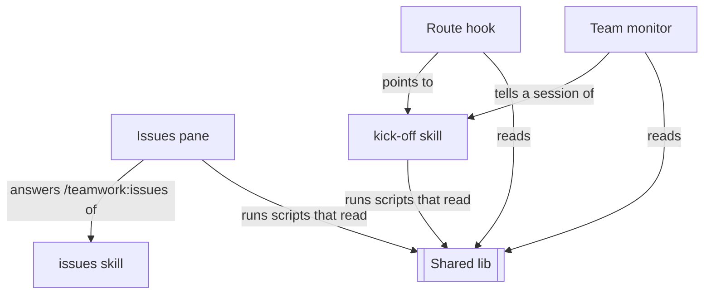
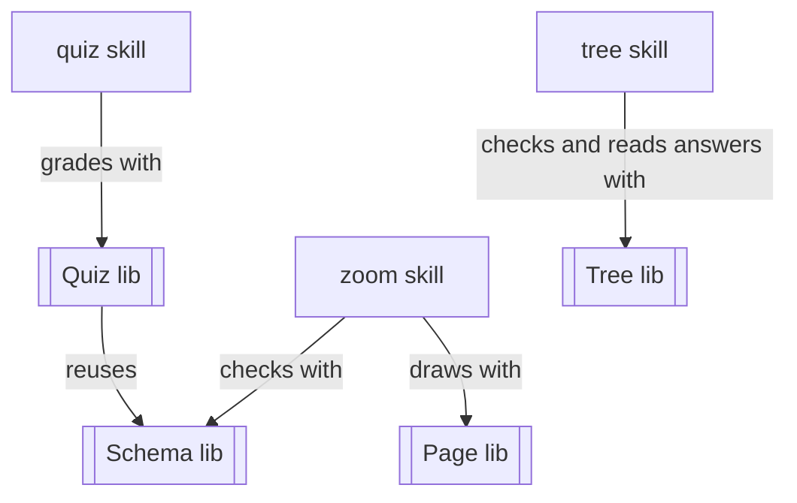
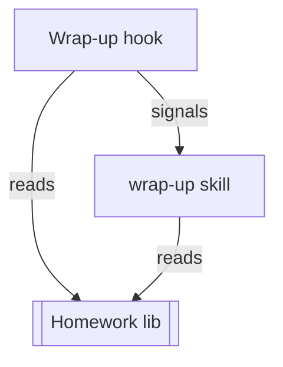

# mumu-claude-plugin: Claude Code plugins

Three Claude Code plugins that let one person run a small team of Claude sessions without losing the plot: **teamwork** turns what you ask for into reviewed, merged work; **paperwork** models a system as a checked document you can prove and draw, and turns a task into a grading spec; **homework** makes sure each session leaves behind what it learned.

Each plugin works alone.

## Audience

These plugins are for a person who uses Claude Code on macOS.

- **teamwork** is for running several Claude sessions on one project kept on GitHub. It needs [herdr](https://herdr.dev), the terminal workspace the sessions run in, and the GitHub command line tool [`gh`](https://cli.github.com/), signed in.
- **paperwork** is for modelling a system or a plan as a checked document, and for writing a grading spec for a task.
- **homework** is for keeping what each session learned, for the next session to read.

## Installation

Add this repository as a marketplace, then install the plugins you want:

```
/plugin marketplace add kalaluthien/mumu-claude-plugin#v0.1.0
/plugin install teamwork@mumu-claude-plugin
/plugin install paperwork@mumu-claude-plugin
/plugin install homework@mumu-claude-plugin
```

What each one needs on your machine; every Python 3 below means Python 3.9 or later, the version macOS ships:

| plugin or feature | needs |
| --- | --- |
| teamwork | Python 3; `git`; [`gh`](https://cli.github.com/), signed in; [herdr](https://herdr.dev), the terminal workspace where sessions live and talk by name |
| paperwork | Python 3 and `git`, with [`uv`](https://docs.astral.sh/uv/); Google Chrome for checking pages and diagrams; Node, `npm` and a Playwright headless Chromium for the optional [pele](https://www.npmjs.com/package/pele) diagrams (`npm` fetches pele on first use, not the Chromium); Java for the optional Alloy proofs (`prove-schema.py --fetch` downloads the Alloy jar) |
| homework | Python 3; `git`; `gh`, signed in, to read the issue comments a session wrote |
| Claude Code | 2.1.299 or later, the highest release the [changelog](https://github.com/anthropics/claude-code/blob/main/CHANGELOG.md) names for a feature below |
| mod `modules`, in teamwork's `hooks/hooks.json` | mods first appear in 2.1.287; the release that added `modules` is not recorded in the changelog |
| `types`, in teamwork's `plugin.json` | first named in 2.1.299, by a validate fix; the release that added it is not recorded in the changelog |
| `SendMessage`, in all three | first named in 2.1.77; the release that added it is not recorded in the changelog |
| `PushNotification`, in teamwork | first named in 2.1.152; the release that added it is not recorded in the changelog |
| `${CLAUDE_SKILL_DIR}`, in homework | added in 2.1.69 |

## Local clone install

This is the way the owner of this repository runs the plugins; the marketplace install above is the way for everyone else. A clone makes a merged change reach your sessions after a `git pull`, with no reinstall.

1. Clone the repository:

   ```
   git clone https://github.com/kalaluthien/mumu-claude-plugin ~/workspace/plugins
   ```

2. Add the clone as a marketplace, in `~/.claude/settings.json`:

   ```json
   {
     "extraKnownMarketplaces": {
       "mumu-claude-plugin": {
         "source": { "source": "directory", "path": "/Users/<you>/workspace/plugins" }
       }
     }
   }
   ```

3. Enable the plugins per project, in the project's git-ignored `.claude/settings.local.json`:

   ```json
   {
     "enabledPlugins": {
       "teamwork@mumu-claude-plugin": true,
       "homework@mumu-claude-plugin": true,
       "paperwork@mumu-claude-plugin": true
     }
   }
   ```

## Versions

Release tags and each plugin's `version` follow the Releases rule under [Repository in AGENTS.md](AGENTS.md#repository).

## Glossary

- **owner**: the person who asks the sessions for work and answers their questions; when you use teamwork, that is you.
- **manager**: the one Claude session per project that writes down what the owner asks for as a GitHub issue, hands it to a worker, and answers the worker's questions.
- **worker**: a Claude session that takes one issue from the manager, splits it into tasks, and builds and merges them in its own copy of the repository.
- **judge**: a new Claude helper that did not write the work and only reviews it, replying `approve` with the exact commit or `fix`, and nothing merges without that approval.
- `BLOCKED:` starts a GitHub issue comment in which a worker asks a question it may not settle alone, and then waits for the answer.
- `DECIDED:` starts a GitHub issue comment that gives the answer, so any later session can read and follow it.

## Teamwork: agent orchestration

<details>
<summary>Structure: The hook, monitor and pane read one shared lib; the skills hold the instructions.</summary>



</details>

Teamwork splits work between a manager, workers and judges, as the [Glossary](#glossary) defines them; [the authority table](teamwork/skills/kick-off/SKILL.md) says what each may decide. The manager never plans tasks or edits code. Each task a worker writes has a goal and checks that fail today, and the worker builds it in its own git worktree.

GitHub issues are the shared memory: the questions and answers on them outlive any session. Pull request policy belongs to each repository, not to the plugin.

The [`kick-off`](teamwork/skills/kick-off/SKILL.md) skill sends a session to its role: [manager](teamwork/skills/kick-off/references/manager.md) or [worker](teamwork/skills/kick-off/references/worker.md). A worker also opens a playbook for the kind of work, such as code, UI or research.

**Usage.** In a herdr workspace, start a session and ask it to manage:

```
Be this project's teamwork manager: fix the login timeout
```

That session becomes the manager. It files the backlog, starts a worker in a new tab, and from then on you mostly answer questions.

- A hook ([`route-event.py`](teamwork/hooks/route-event.py)) tells each session at start what waits on it, and keeps a worker from going idle while an issue it holds is open.
- A monitor ([`print-team-gaps.py`](teamwork/monitors/print-team-gaps.py)) tells the manager where GitHub and the team disagree, and wakes a worker when its wait ends.
- `/teamwork:issues` shows the Issues pane, a board of the open issues, again after you close it.

## Paperwork: system models and grading specs

<details>
<summary>Structure: Each skill calls the library of its own job; the Quiz lib reuses the Schema lib's document shape.</summary>



</details>

One Schema document holds what a system is, or must be, and every view is drawn from it after a checker passes it.

- [`/paperwork:zoom`](paperwork/skills/zoom/SKILL.md) models a system, from code, docs or requirements, as a checked Schema document, then proves it with Alloy (needs Java) or shows it as a Mermaid diagram in chat, a clickable HTML page or an SVG.
- [`/paperwork:quiz`](paperwork/skills/quiz/SKILL.md) turns a task into a grading spec for a judge, a benchmark or a human grading sheet, and measures or repairs it.
- [`/paperwork:tree`](paperwork/skills/tree/SKILL.md) writes a plan as one checked JSON document, shows it as a page where the owner picks, strikes, comments and edits, and reads the copied Answer back into the plan's next version.

**Usage.**

```
/paperwork:zoom map how the release pipeline works
/paperwork:zoom prove that two workers never hold the same worktree
```

## Homework: session lessons and memory

<details>
<summary>Structure: The hook only counts and signals; the skill does the writing.</summary>



</details>

Keeps what a session learned, once, where the next reader will look.

- A Stop hook ([`signal-wrap-up.py`](homework/hooks/signal-wrap-up.py)) counts new lessons in the transcript, changed memory files, and whether the repository has a known way to run and verify itself. When a count crosses its line, it sends a one-line wrap-up signal.
- The [`wrap-up`](homework/skills/wrap-up/SKILL.md) skill acts on the signal, or on your ask. It keeps a lesson (retro), tidies memory (dream), writes a run recipe for a repository with none, and finds recurring patterns (dejavu). Its playbooks are in [`references/`](homework/skills/wrap-up/references).
- Every memory file says when it applies and when it would be wrong, so a stale lesson can be spotted.

**Usage.** The signal arrives on its own, and the skill is not in the slash menu. To ask for it yourself, tell Claude to keep a lesson (retro) or tidy memory (dream). It asks you nothing and reports what it did.

## Contributions

- The rules every plugin follows are in [AGENTS.md](AGENTS.md), from [Plugin layout](AGENTS.md#plugin-layout) on.
- [CONTRIBUTING.md](CONTRIBUTING.md) says how to report a problem or ask a question.
- With a local clone, [Repository in AGENTS.md](AGENTS.md#repository) says when a merged change reaches a running session.

## License

[Apache-2.0](LICENSE); third-party works it uses are named in [NOTICE](NOTICE). This project is not affiliated with Anthropic.
