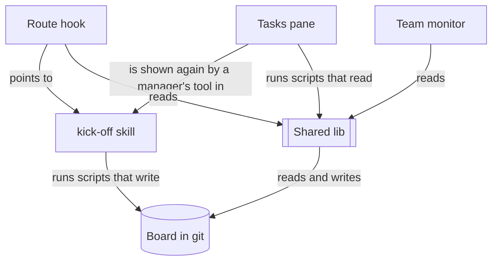
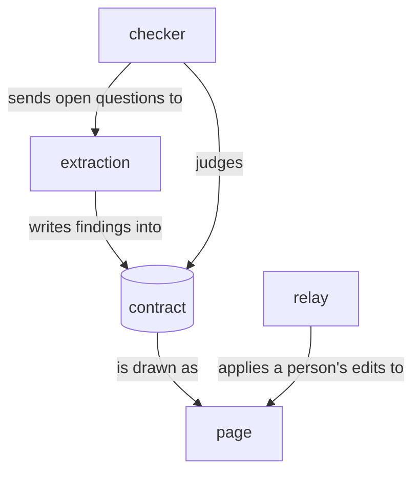
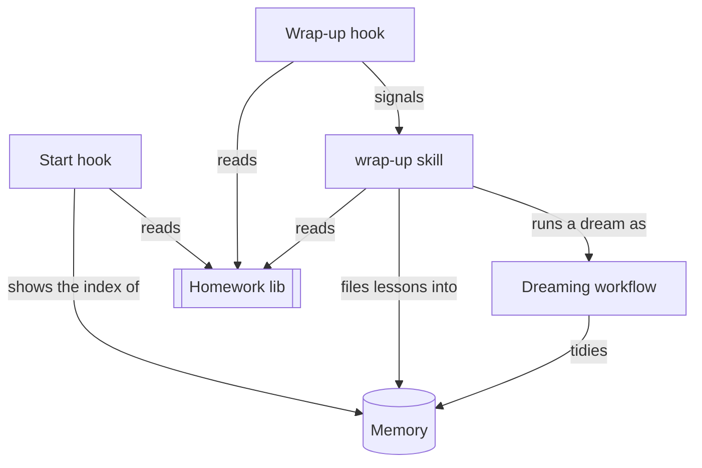

# mumu-claude-plugin: Claude Code plugins

[](https://buymeacoffee.com/kalaluthien)

This marketplace holds three Claude Code plugins for one person who works with several Claude sessions at once. Each plugin works alone, so install only the ones you need.

| plugin | install it when you want to | a first thing to try; its section's First run gives the steps |
| --- | --- | --- |
| **teamwork** | hand a job to Claude and get it back reviewed and merged, while you only answer questions | in a herdr tab: "Be this project's teamwork manager: fix the login timeout" |
| **paperwork** | understand or explain a system, a process or a set of requirements, as a page you can browse | `/paperwork:system describe how the release pipeline works` |
| **homework** | stop Claude from repeating a mistake you already corrected in another session | add one setting, then correct a session and say "keep this as a lesson" |

Of the plugins' skills, only `/paperwork:system` is one you type as a slash command. Everything else starts from plain words: you say what you want, and the session loads the skill it needs.

## Installation

Type the lines for the plugins you want inside a Claude Code session, then run `/reload-plugins` once:

```
/plugin marketplace add kalaluthien/mumu-claude-plugin
/plugin install teamwork@mumu-claude-plugin
/plugin install paperwork@mumu-claude-plugin
/plugin install homework@mumu-claude-plugin
```

`/plugin` lists what is installed; uninstall a plugin there too. The first line adds this GitHub repository as a marketplace.

| plugin | needs on your machine |
| --- | --- |
| all | Claude Code (`claude --version` shows it; `claude update` updates it); Python 3.9 or later (`python3 --version`), which macOS ships |
| teamwork | Claude Code 2.1.299 or later; macOS, since the side pane that lists your tasks waits for changes through a macOS-only call; `git`; [herdr](https://herdr.dev), a terminal app that holds each Claude session in its own tab so sessions can message each other by tab name; `gh`, signed in with `gh auth login`, only when your repository takes changes as GitHub pull requests |
| paperwork | Claude Code 2.1.98 or later, since `relay` watches its page server with Claude Code's Monitor tool; a browser to open the pages it makes |
| homework | Claude Code 2.1.224 or later; macOS or Linux for the memory clean-up, whose scripts lock files with Python's `fcntl`, which Windows lacks; `git`; `gh`, signed in with `gh auth login`, so it can tell your own repositories from copies of others'; herdr only when a session that cannot run a workflow opens a second session for a **dream**, the memory clean-up described under Homework, or when a session types a slash command only a person can type into its own tab; without herdr, the session tells you it started no second session, and asks you to type the slash command |

## Teamwork: hand over a job, get back merged work

You make one session the **manager** of your project. You tell it what you want. It writes your ask down as a **task**, starts a **worker** session in a new tab, and the worker builds the change in its own copy of the repository. A fresh reviewer, the **judge**, checks the work, and only then does the worker merge it. Your part is to answer questions.

### Before you start

1. Install herdr as [herdr.dev](https://herdr.dev) says, and start it with `herdr` in your usual terminal.
2. In a herdr tab, run `echo $HERDR_PANE_ID` in the shell: it prints the pane id inside herdr and nothing outside it. Then go to your repository's folder and start `claude`. A `claude` already running outside herdr must be quit with `/exit` and started again here.
3. Make sure the repository is a git repository with a commit on its main branch: workers branch from it and merge back into it.

### Words

| word | meaning |
| --- | --- |
| manager | the one session per project that turns your words into tasks, starts workers and answers their questions; its tab is named `<project>-manager` |
| worker | a session that takes one task, splits it into parts, and builds and merges each part in its own git worktree, a separate copy of the repository |
| judge | a fresh helper that did not write the work; it runs the task's checks and answers `approve` or `fix`, and nothing merges without its approval |
| sentinel | a light session the manager starts for one duty that never ends, such as answering comments on a page |
| task | one unit of work: a goal and a definition of done, each item a check that fails before the change and passes after it, or a rubric a judge scores |
| board | the list of tasks with their comments, kept in your repository's local git (`refs/teamwork-blackboard`), so it outlives every session and never goes to GitHub |
| `BLOCKED:` | a comment on a task where a worker asks a question it may not settle alone |
| `DECIDED:` | a comment that answers it; it binds every later session until a newer decision replaces it |

[The authority table](teamwork/skills/kick-off/references/protocol.md#authority) says what each role may decide alone and what it must ask.

### First run

1. Type `Be this project's teamwork manager: fix the login timeout`, with your own ask after the colon. Any words that make the session the manager work, such as "promote yourself to teamwork manager".
2. The manager files the task on its board and starts a worker in a new herdr tab. The Tasks pane opens beside the manager's chat and lists the task.
3. When a worker needs you, the manager asks you in its own tab. A question with numbered options takes the number alone, such as `2`.
4. Nothing merges until a judge approves its exact commit. Then the worker merges into your main branch and pushes it to `origin` when there is one, or opens a GitHub pull request when your repository's rules, such as its `AGENTS.md` or `CONTRIBUTING.md`, say changes land that way. To hold a change back, tell the manager while the task is still open, before its judge approves; you may decide anything, as the authority table above says.
5. The manager tells you when the task is done.

Each worker and judge is its own Claude session or subagent, so one task spends several sessions' worth of usage.

### Skills

| skill | when it runs | what you do |
| --- | --- | --- |
| [`kick-off`](teamwork/skills/kick-off/SKILL.md), as manager | you make a session the project's manager | say the role and your ask |
| `kick-off`, as worker | the manager starts a worker for a task | nothing; answer its questions when the manager relays them |
| `kick-off`, as sentinel | the manager needs one duty done without end | ask the manager for the duty |
| `kick-off`, succession | you want a fresh manager, such as when the old one's context is long | ask the manager to hand over; the new one closes the old one and takes its name |

### Hooks, monitor and pane

These run by themselves; you never call them.

| part | when it runs | what it does for you |
| --- | --- | --- |
| [`route-event.py`](teamwork/hooks/route-event.py) | a session starts | tells a manager, worker or sentinel its role and what waits on it; says where to install herdr when it is missing |
| `route-event.py` | a manager, worker or sentinel runs a shell command | reminds it of the rules a board command must keep; refuses a write to a GitHub issue, since team work lives on the board; stops a worker from changing directory into your main checkout, so its edits stay in its own copy |
| `route-event.py` | a worker tries to stop | sends it back to work once while a task it holds is still open, unless a helper or a check it waits on still runs |
| [`print-team-gaps.py`](teamwork/monitors/print-team-gaps.py), the `heartbeat` monitor | while a manager has a worker, and in each worker | tells the manager where the board and the team disagree and what fixes it, and passes on each report meant for you; wakes a worker when what it waited for arrives |
| Tasks pane (pane id `teamwork-tasks`), [`draw-task-pane.tsx`](teamwork/hooks/draw-task-pane.tsx) | opens once when a session becomes a manager | shows the open tasks as a tree with a search box on top; select a task to read it whole; ask the manager to show the pane again after you close it |

<details>
<summary>Structure: The hook, monitor and pane read one shared lib, and the skill's scripts write the board.</summary>



</details>

### Examples

These come from the sessions and test runs of the plugins' author, named "the author" in the examples below.

**Making a manager**

- *"Promote yourself to teamwork manager."* typed into a fresh session. It loaded the skill as manager and handled every later ask as a task.
- *"Start a paperwork manager and send it this:"* followed by a numbered list of changes. The manager filed one task with the list as its goal and started a second manager, for the `paperwork` folder, with the task's link.
- *"Start a manager for my other repository too, and have it fix that README."* The manager started a manager in that repository's folder, so each project keeps its own board.

**Giving the manager work**

- *"Read this patch, make it a task too, and go ahead."* with a patch file's path. The manager read the patch, filed it and started a worker.
- *"Make option 2 a task."*, later *"Queue a task that also checks the page layout."*, and at the end of the day *"Run everything that was queued."* The manager filed each ask as a task that waits, then started a worker for each when told to go.
- *"A ticket just came in, go ahead."* The manager read the board, saw a live worker already held it, and said there was nothing to do.

**Answering questions**

- The manager asked how to draw an area with dashed lines, with numbered options; *"2"* settled it, and the manager wrote it on the task as a `DECIDED:`.
- *"2. But white won't show when filled, so …"*: a number plus a correction. The decision kept both.
- *"Add them all."* after the manager made three proposals in a row of replies. The manager added them to the task as one decision.

**Talking to a worker in its own tab**

- *"Go ahead with the work."* The worker set up its copy of the repository and started the task.
- *"Why did this hook go wrong?"*, then a pasted line of a stop hook's error. The worker reproduced it, found that the hook crashed when run outside a git repository, and filed the fix as a new task.
- *"Hand it over."* when its part was done. The worker handed a follow-up it had proposed to the manager to file.
- *"Move the team."* The worker moved its tab under the other project's manager.

**When something looks wrong**

- *"Two workers exist but they are not in the Tasks pane."* The manager ran the pane's list script, [`list-task-board.py`](teamwork/hooks/list-task-board.py), found the pane shows only its own project's tasks, and started the other project's manager.
- *"A waiting mark sometimes stays after I answer; find out why and fix it."* The manager filed it as a task and gave it to a worker, told to list candidate causes, check them against the board's records, and fix them with one rule.
- *"Close yourself."* The manager checked that no worker still needed it and closed its tab.

**Sentinels**

- *"Can a page in a temporary folder be linked to a session, so a comment I type on it reaches the session, which edits and reloads the page?"* The session answered that it could be done but had not been tried yet.
- *"Have your own worker build the test prototype and connect a sentinel to it."* The manager started a worker for the prototype, then a sentinel to answer the comments on its page.
- In scripted tests of the same idea, a sentinel was started for a test page and told to answer the comments on it.

**Tips**

- Say the role and the ask in one line; the manager files the task, so you never write one yourself.
- Short go-signals work: "go ahead", "hand it over", "run everything that was queued".
- When a pane or a hook looks wrong, say what you see as a question; the manager finds the cause and files the fix.

## Paperwork: a description someone can rebuild from

Paperwork writes down a subject, such as code, a process or requirements, as one **contract**: a JSON file that holds its parts and how they connect, at **levels** small enough to read at once, its **scenarios** (step-by-step flows), and each question no source answers, kept as a named **gap**. A checker refuses a contract that breaks its rules, such as a part that does not say its purpose; then a fresh reader tests whether the subject could be rebuilt from the contract alone.

### First run

1. In a session started in the folder that holds your subject, such as a repository, type `/paperwork:system describe how <your subject> works`, or say the same in plain words.
2. The session reads the sources, asks you what they do not settle, and writes the contract.
3. It turns the checked contract into one standalone HTML page and gives you its path: open it in a browser. The page shows a diagram per level, a card for whatever is under the pointer, playable scenarios, and search (press `/`).
4. To change something by commenting, ask the session to open the page for comments: the `relay` skill serves it at a local link, which you open instead of the file, and brings each comment back to the session.

[A finished example page](paperwork/skills/system/examples/self/page.html), of the `system` skill itself, shows what you get: clone the repository, or save the file's raw view, and open it in a browser.

### Skills

| skill | when it runs | what you do |
| --- | --- | --- |
| [`/paperwork:system`](paperwork/skills/system/SKILL.md) | you want a subject described | type the command with your subject, or ask in plain words |
| [`relay`](paperwork/skills/relay/SKILL.md) | you comment on, fill in or edit a local HTML page, and the change must go into the page's file | open the local link the session gives you, and edit there; the skill is not in the slash menu, since the session loads it |

`relay` serves the page only on your machine (`127.0.0.1`), behind a link with a random secret part. Each comment you leave on a part reaches the session, which applies it, replies under your comment and reloads the page; for a page `system` made, it changes the contract and builds the page again. Paperwork ships no hooks and no plugin monitors; `relay` starts its page server only while a session serves a page.

<details>
<summary>Structure: Extraction feeds the contract, the checker sends open questions back, and the page shows it.</summary>



</details>

### Examples

These come from building paperwork itself with teamwork, whose manager, worker and sentinel sessions are defined under Teamwork; the sentinel cases are scripted test runs.

**`system`**

- *"Name nodes and areas as capitalized noun phrases without articles; levels, scenarios and properties as short slugs."* The session filed the rule as a task, then reported a table of example names.
- *"Improve each search result; look at what people like on the web, such as how results are excerpted and highlighted."* A worker took it as a task. The manager then proposed ranking scores and other changes, and *"add them all"* put them into that task.
- *"Does the system skill not add search by itself?"* The session read the page playbook and answered that every page gets search.
- A design talk in small steps: *"Less busy, and without the legend?"*, then *"Is there an area that is not a region?"*. The session answered with tables, then offered numbered shape options; *"2"* settled it, and the session recorded the choice.

**`relay`**

- *"A simple diagram where I can comment on each node like a chat thread, and you change the diagram when I ask."* The manager wrote that shape into a task: a comment on a node reaches a sentinel with the diagram around it, the replies pile up per node, and a comment can add, remove, rename or join nodes.
- *"It must be built as a standalone HTML file and fit relay."* The manager recorded that every `system` page is one file, and that relay's page check must accept it.
- A test page with four comments, given to a sentinel: it renamed or added nodes as three comments asked, skipped an undo that changed nothing, and declined to edit a file outside the page, saying so in its reply.
- Another test page, where a comment on the build step asked only for a reply: the sentinel replied, changed nothing on the page, and left alone the items another session had added.

**Tips**

- Paste a screenshot of a page you like and ask "can this page do that too?"; the session answers from what the page can do.
- Answer a numbered question with the number, and add a sentence when you want the option changed.

## Homework: lessons that carry over

Claude Code keeps an **auto-memory**: note files a session reads before it acts, listed in a `MEMORY.md` index. Homework makes each session add what it learned, a **lesson**, to that memory, once, where the next session will read it, and regularly cleans up what earlier sessions kept.

### First run

1. Make the folder with `mkdir -p ~/.claude/memory`, then name it for every session in `~/.claude/settings.json`, as one more key of the object already there, or as the whole file when there is none; every project's sessions then read and write memory in that folder instead of each project's own, so copy into it any older notes you want to keep:

   ```json
   { "autoMemoryDirectory": "~/.claude/memory" }
   ```

2. To try it at once, correct a session on something and say "keep this as a lesson"; it runs a **retro** and files the lesson. Otherwise work as usual: when a session in a git repository stops after enough happened, it gets a line that starts `Wrap-up signal:` and runs a retro before it stops: it reviews what went wrong or what you corrected, and files each lesson in that folder, or hands a rule-file or script change to you as a patch.
3. Read `~/.claude/memory/MEMORY.md` to see what was kept. Each situation is one file, its lessons under it, with a line in that index.
4. After 8 or more memory files change, a **dream** cleans up: it backs memory up, reads recent sessions of every project on this machine, finds mistakes that keep coming back and how you like to work, and tidies every memory folder. It asks you before it hands over a mistake that keeps coming back, a way you like to work, or a fix that widens a permission or a guard. For each lesson about a skill, it also asks whether to write it into that skill, keep it in memory, or drop it.

Memory's history stays on your machine, in `~/.claude/memory.git`. A fix outside memory goes to the session in charge of that project, or is made there the way the project takes changes; for a repository that is not yours, it is written as a patch for you to apply. To turn the asks off for a repository, add this key to its `.claude/settings.local.json`, merging it into the object already there:

```json
{ "env": { "HOMEWORK_WRAP_UP": "off" } }
```

[homework/README.md](homework/README.md) says what it writes where.

### Skills

| skill | when it runs | what you do |
| --- | --- | --- |
| [`wrap-up`](homework/skills/wrap-up/SKILL.md), retro | at a `Wrap-up signal:`, or when you ask to keep a lesson | nothing, or say "keep this as a lesson" |
| `wrap-up`, dream | 8 or more memory files changed since the last dream, and a clean-up is due | answer its questions, which it numbers |


### Hooks and workflow

A **workflow** is a script Claude Code runs as a set of helper agents, offered under the plugin's name.

| part | when it runs | what it does for you |
| --- | --- | --- |
| [`print-repository-memory.py`](homework/hooks/print-repository-memory.py) | a session starts | tells the session where lessons go, and shows the index of the lessons true only in this repository, kept in a subfolder of the memory folder named for it |
| [`signal-wrap-up.py`](homework/hooks/signal-wrap-up.py) | a session in a git repository stops | after enough failed or total tool calls since the last stop, or at a session's 25th tool call, asks the session to run a retro with a line opening `Wrap-up signal:`; the same line counts memory files changed since the last dream |
| [`dreaming-workflow.js`](homework/workflows/dreaming-workflow.js), offered as `homework:dreaming-workflow` | a dream starts | maps recent sessions in batches, digs into the most repeated mistakes and your preferences, tidies every memory folder, and puts back each lesson a past correction still needs |

A session that cannot run a workflow hands the dream to a **Dreamer**, a separate session it opens in a new herdr tab; outside herdr none starts, and the session tells you so. To let it open one, start Claude Code from a herdr tab ([herdr.dev](https://herdr.dev)); a later due dream then opens its Dreamer, unless another dream is still running.

<details>
<summary>Structure: The hooks only count and signal; the skill does the writing, and a dream runs as a workflow.</summary>



</details>

### Examples

**Retro**

- *"The real problem seems to be repeating runs while fixing the wrong thing; run a retro on it and fix it."* The session found that most of a costly piece of work came from test sessions started again from the beginning; its guess was that a script fix, a criterion edit or a review each started them again. It filed a rule against that as a lesson and handed it to the teamwork manager, which filed it as a task.
- A sentinel answering page comments stopped, and the hook's signal started its first retro. Its one candidate was a line the start hook had added, not a lesson, so it filed nothing.
- Another sentinel's retro, started the same way, found one candidate that needed the owner's confirmation, since a sentinel may not write outside its page; it filed nothing and said what it would need.
- A worker stopped after three failed commands, and the hook's signal started a retro. The retro found each failure already caught by a guard or caused by its own misreading of a usage line, filed nothing, and the hook asks a little less often after such an empty wrap-up.

**Dream**

- The Dreamer reported a mistake seen in 17 sessions and asked whether to hand its fix over. *"Approved. What about the unfinished part?"* It recorded the fix for the author, since no session ran in that project, and left the unfinished batch to the next dream.
- The Dreamer asked numbered questions; *"(1) remove that hook everywhere"* settled one, and later the author answered its two open questions by their numbers.
- *"Dreaming seems frequent; what triggers it?"* The session read the hook's counts and explained them; the author then asked to skip a dream while only a few files had changed, and a dream starts only once 8 have changed.
- *"Fix it yourself, commit and push."* typed into the Dreamer's tab, about a fix it proposed for a repository the author keeps. It made the change the way that repository takes changes.

**Tips**

- When a session repeats a mistake you corrected before, say "keep this as a lesson".
- Answer the Dreamer's numbered questions with the numbers.

## Contributions

- The rules every plugin follows are in [AGENTS.md](AGENTS.md), from [Plugin layout](AGENTS.md#plugin-layout) on.
- [CONTRIBUTING.md](CONTRIBUTING.md) says how to report a problem or ask a question, and how to run a local clone.

## License

[Apache-2.0](LICENSE); third-party works it uses are named in [NOTICE](NOTICE). This project is not affiliated with Anthropic.
