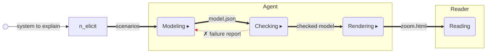
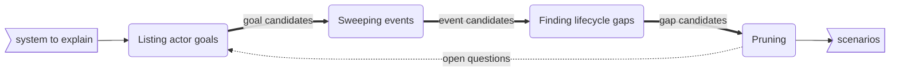
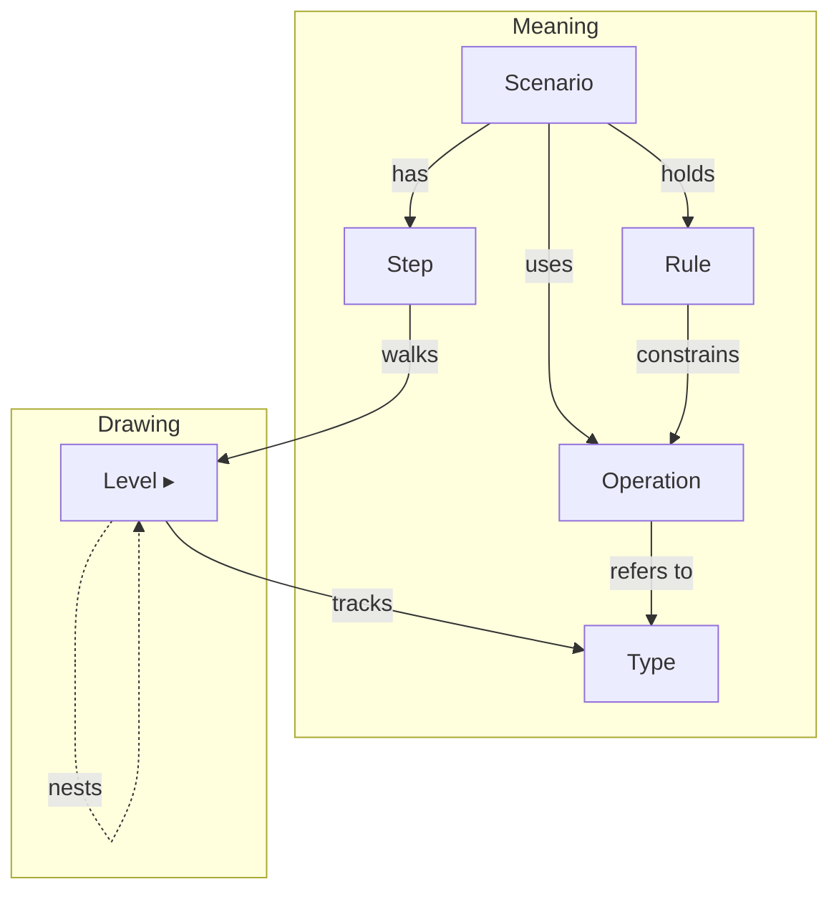
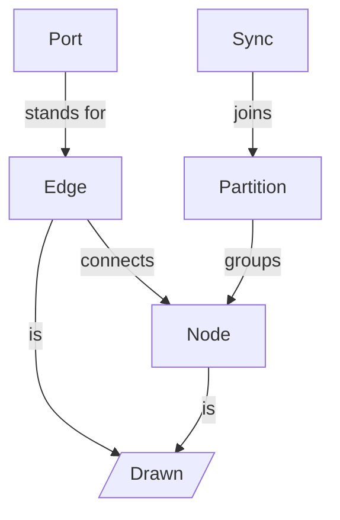
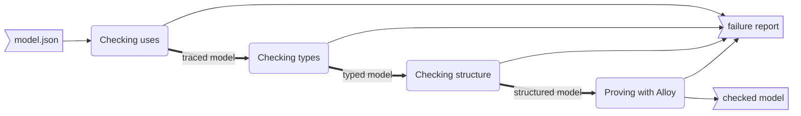
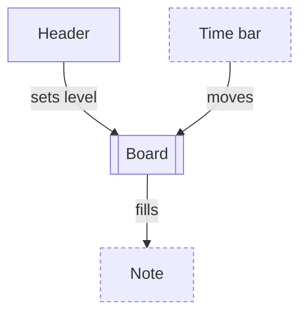

## zoom

```text
root: Lifecycle (workflow)
├── elicit: Finding uses (workflow)
├── model: Model file (topology, view)
│   └── level: Level parts (topology, nest)
├── check: Checks (workflow)
└── render: Zoom diagram (topology, view)
```

### `root` Lifecycle (workflow)

_줌 다이어그램 하나가 만들어져 독자에게 읽히기까지 거치는 다섯 단계입니다. 단계마다 일을 마치면 결과를 다음 단계로 넘기고, 검사에서 문제가 나오면 모델 단계로 되돌아갑니다._



### `elicit` Finding uses (workflow)

_쓰임 후보를 세 번 훑어 찾고 거르는 순서입니다. 행위자의 목표로 뽑고, 바깥 사건으로 다시 훑고, 기록마다 비는 칸을 질문으로 삼은 뒤, 단계이거나 다른 쓰임의 합인 후보를 버립니다. 한 바퀴 돌아도 새로 남는 쓰임이 없으면 멈춥니다._



### `model` Model file (topology)

_모델 파일 하나가 무엇으로 이루어졌는지 보여 줍니다. 위 구역은 시스템이 무엇을 하는지(Meaning), 아래 구역은 그것을 어떻게 그리는지(Drawing)입니다._



### `level` Level parts (topology)

_레벨 한 장이 무엇으로 그려지는지 보여 줍니다. 노드와 선은 이름과 표시를 가진 그려지는 것이고, 바깥에서 들어오는 트리거는 출발 노드가 없는 선입니다. 포트는 부모 레벨의 결과물이 드나드는 자리, 동기화는 상태 레벨의 영역을 잇는 규칙입니다._



### `check` Checks (workflow)

_모델에 빠진 것, 남는 것, 어긋난 것이 없는지 차례로 확인하는 네 묶음의 검사입니다. 마지막 묶음은 Alloy가 모델을 직접 풀어 봅니다. 어느 검사에서든 걸리면 실패 보고서가 나가고, 모두 통과하면 모델이 그대로 나갑니다._



### `render` Zoom diagram (topology)

_완성된 줌 다이어그램 화면이 어떤 부분으로 나뉘고, 부분끼리 무엇을 주고받는지 보여 줍니다._


